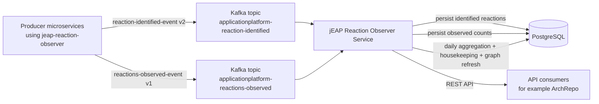

# Architecture

jEAP Reaction Observer Service is the consumer and aggregator for the events emitted by the sibling
[jEAP Reaction Observer library](https://jeap-admin-ch.github.io/docs/building-blocks/libraries/jeap-reaction-observer/getting-started).
It stores two kinds of information:

- identified reactions: the structural trigger/action pattern of a reaction
- observed reactions: counted occurrences of those reactions within a timeframe

The persisted data is aggregated into a graph-oriented read model served over HTTP.

## Runtime flow

## Modules

| Module | Responsibility |
|---|---|
| `jeap-reaction-observer-domain` | Domain model, repository interfaces, graph filtering, graph building, aggregation service |
| `jeap-reaction-observer-kafka` | Kafka listeners that transform incoming Avro events into domain objects |
| `jeap-reaction-observer-persistence` | JPA entities, JDBC/JPA repository implementations, Flyway migrations |
| `jeap-reaction-observer-web` | Spring Boot application, HTTP API, in-memory graph snapshot, scheduling, security, OpenAPI |
| `jeap-reaction-observer-service-test` | Shared event builders and test model objects for integration tests and consumers |
| `jeap-reaction-observer-service-instance` | POM-only packaging module for downstream service instances |

## Write path

### Reaction definitions

`ReactionIdentifiedEventListener` consumes `reaction-identified-event` messages and stores a `Reaction` containing:

- producer system name, normalized to lower case
- producer component/service name
- reaction id
- optional trigger observation
- zero or more action observations
- identification timestamp

The incoming event payload can contain a full reaction, trigger-only payload, or action-only payload; all three forms are handled.

Every observation is stored with its type and FQN as reported, whatever the type: `event` and `command`
(messages), `http_request` (HTTP operations), and any type the service does not know yet. The type and FQN of an
interface can be up to 1024 characters long; the library cuts FQNs at 512 characters.

### Observed counts

`ReactionsObservedEventListener` consumes `reactions-observed-event` messages and stores `ObservedReaction` records with:

- component name from the event publisher service
- reaction id
- timeframe start/end
- count

Persistence is idempotent per event idempotence id: `ObservedReactionRepositoryImpl` saves a batch only if no row with the
same idempotence id exists yet.

A count of a reaction id that has not been identified is **skipped**, and the other counts of the event are saved.
The skipped counts are logged and counted in `reaction_observer_service_unknown_reaction_counts_total` (see
[Metrics](metrics.md)). The known reactions of an event are looked up with one query per component.

:::warning Counts that arrive before their reaction is identified are lost

Until 12.17, one unknown reaction id failed the whole `reactions-observed-event`, which ended up in the error
handling - and since an instance reports every five minutes until it restarts, so did every later count of that
instance. Since 12.18, such a count is dropped instead. This happens when counts are processed before the
identification of their reaction, for example while a backlog is consumed after a deployment of the service. The
metric shows how often it happens.

:::

## Persistence model

Flyway creates four main tables over time:

- `reaction` for identified reactions
- `observation_property` for trigger/action properties
- `observed_reaction` for raw timeframe-based counts
- `observed_reactions_aggregated` for daily aggregated counts

Later migrations add ShedLock support, multi-action storage, the producer system name, an idempotence index, an
interface table used to normalize trigger/action interface definitions, and longer interface columns (`type` and
`fqn` up to 1024 characters, observation ids up to 4096, as an id embeds its encoded FQN).

## Aggregation and graph building

`ScheduledTasksService` coordinates recurring jobs. The three that **write** hold a ShedLock, so exactly one
instance performs them:

- aggregate yesterday's raw observations into `observed_reactions_aggregated`
- delete raw `observed_reaction` rows whose timeframe starts before today
- delete aggregated rows older than the configured statistics window

The graph refresh does **not** hold one, and must not:

- rebuild the in-memory graph on a schedule and once at startup

The graph is held per JVM in `GraphHolder`, and rebuilding it writes nothing - it reads the reactions and the
aggregated observations and replaces a field. A lock would therefore let one instance refresh and leave every
other one serving the graph it built while it started, for as long as that instance lives. With more than one
replica that is a stale answer, and - since the entity tags of the API are derived from the graph - an index
from one replica and content from another that disagree. The startup refresh has always run unlocked on every
instance for the same reason.

A refresh also builds the **snapshot** the API answers from: the graph plus the fingerprint of every subgraph
that can be asked for. That is what lets an index be a lookup rather than an extraction of every subgraph, and
a conditional request be answered without extracting, serializing or hashing anything - see
[REST API](rest-api.md).

`ReactionGraphRepositoryImpl` builds the full graph from persisted reactions:

- interface nodes come from normalized `InterfaceEntity` rows
- reaction nodes represent producer components within systems
- trigger edges connect an interface -&gt; reaction
- action edges connect a reaction -&gt; interface

`InterfaceNodeFactory` creates the interface node from the observation type and FQN, with one parser per type:

| Type | Node | FQN |
|---|---|---|
| `event`, `command` | `Message` | `messageType` or `messageType/variant` |
| `http_request` | `HttpOperation` | `provider METHOD pattern`, split at the first two spaces |
| any other | `GenericInterface` | kept as it is |

The kind of node is a hint for how to present it; the identity of an interface remains its type and FQN. If the
parser of a known type cannot parse an FQN, the factory does not fail: the interface becomes a `GenericInterface`
and is counted, once per interface and instance, in `reaction_observer_service_unparsable_interfaces_total` (see
[Metrics](metrics.md)). A single interface reported wrongly therefore cannot break the graph of the whole landscape.

`ReactionGraphBuilderService` reads the reactions observed since `fromDate` and the median daily count of each,
hands the medians to the repository so that reaction nodes and trigger edges are built with them, and filters
the graph to those reactions.

The medians are built into the graph rather than applied to a finished one, because nodes and edges hold the
same `Reaction` records: enriching only one of the two would leave records that no longer compare equal, and
`GraphExtractor` matches an edge to its node by value.

## Read path

`GraphHolder` stores the current graph in memory: the full graph with every kind of interface node, and the view
of it the API v1 serves, which only has message nodes (see [REST API](rest-api.md#messages-only-in-the-api-v1)).
`GraphController` serves, from that view:

- the full graph
- a graph filtered to one system
- a graph filtered to one component
- one subgraph per variant of a message type

Each response includes a fingerprint produced by `GraphFingerprintCalculator` from canonical JSON so consumers can detect changes.

The repository also exposes supporting lookup/statistics endpoints for known systems, known components, and the last
observation date per component. This API shape matches the service's role as an internal source for system-behaviour tooling.

## Related

- [Getting started](getting-started.md)
- [Configuration reference](configuration.md)
- [REST API](rest-api.md)
- Producer-side library docs: [jEAP Reaction Observer library](https://jeap-admin-ch.github.io/docs/building-blocks/libraries/jeap-reaction-observer/getting-started)
